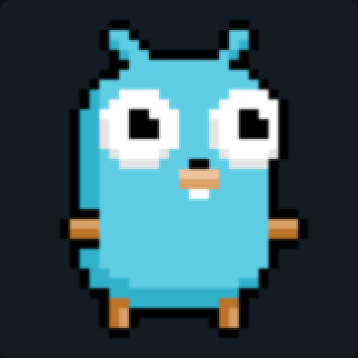

<!-- =============== HEADER =============== -->

<h1 align="center">
  ❄️ Chintukr2004 — Developer ❄️
</h1>

  

<!-- =============== GO GOPHER =============== -->

  

<h3 align="center">
  umm.. ya i kinda like golang 🐹
</h3>

  <b>building things, breaking things and learning how things work.</b>

  
  
  

<!-- =============== ABOUT ME =============== -->

## 👨‍💻 about me

- 🎓 Computer Science Engineering student.
- 🐹 Currently focused on Go backend development.
- ⚙️ Interested in building reliable backend systems.
- 🗄️ Working with PostgreSQL and REST APIs.
- 🌐 Exploring Node.js and TypeScript.
- 🐳 Learning Docker and deployment.
- 🧠 Interested in system design and distributed systems.
- 🚀 Always building something and learning something new.

<!-- =============== TECH STACK =============== -->

## ⚡ tech stack

### Languages

  

### Backend & Frameworks

  

### Database & Infrastructure

  

### Tools & Environment

  

<!-- =============== PROJECTS =============== -->

## 🚀 things i've built

<table>
  <tr>
    <td width="50%">
      <h3>🐹 student-api</h3>
      
REST API built with Go and PostgreSQL.

      <a href="https://github.com/Chintukr2004/student-api">View Repository →</a>
    </td>
    <td width="50%">
      <h3>⚙️ REST-API-GOLANG</h3>
      
Backend development and REST API implementation using Go.

      <a href="https://github.com/Chintukr2004/REST-API-GOLANG">View Repository →</a>
    </td>
  </tr>
  <tr>
    <td width="50%">
      <h3>🔐 simple-auth-microservice</h3>
      
Authentication-focused backend microservice project.

      <a href="https://github.com/Chintukr2004/simple-auth-microservice">View Repository →</a>
    </td>
    <td width="50%">
      <h3>🛠️ groundwork-dev</h3>
      
Backend development project.

      <a href="https://github.com/Chintukr2004/groundwork-dev">View Repository →</a>
    </td>
  </tr>
</table>

  

<!-- =============== CURRENTLY LEARNING =============== -->

## 📚 currently learning

- Go concurrency and goroutines.
- PostgreSQL and database optimization.
- Docker and containerization.
- Microservices architecture.
- System design fundamentals.
- Scalable backend architecture.

<!-- =============== GITHUB STATS =============== -->

## 📊 github analytics

  
  

  

<!-- =============== CONTRIBUTIONS =============== -->

## 🐍 contribution graph

  

<!-- =============== PERSONAL SECTION =============== -->

## 🤔 random facts about me

- 🐹 Go is my current favorite.
- 💻 I spend time understanding how backend systems work.
- 🔍 I enjoy debugging more than I probably should.
- ⚙️ I believe good software starts with good engineering.
- ☕ Still learning, still experimenting.

<!-- =============== CONNECT =============== -->

## 🤝 let's connect

  
  
  

<h3 align="center">
  🐹 Go is fun. Building things is better. 🚀
</h3>

  <i>Thanks for visiting my corner of GitHub!</i>

